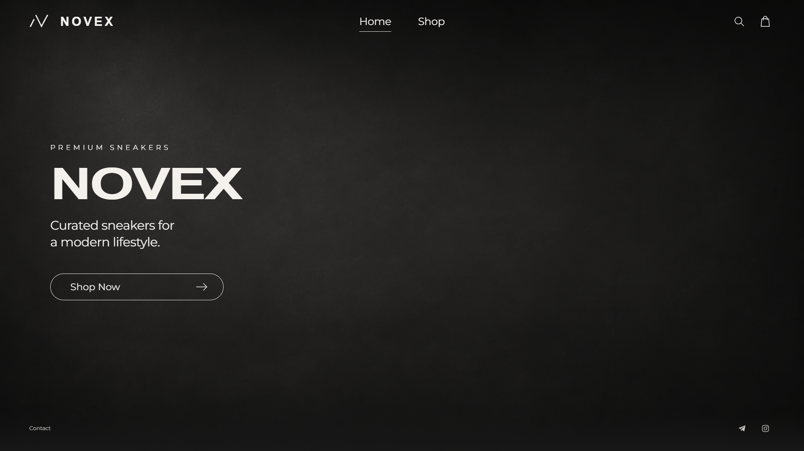
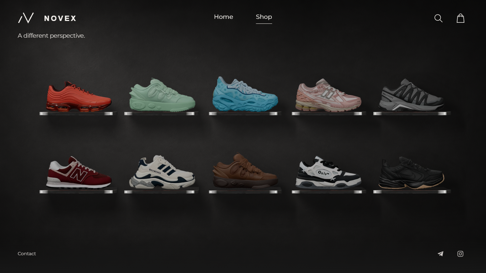
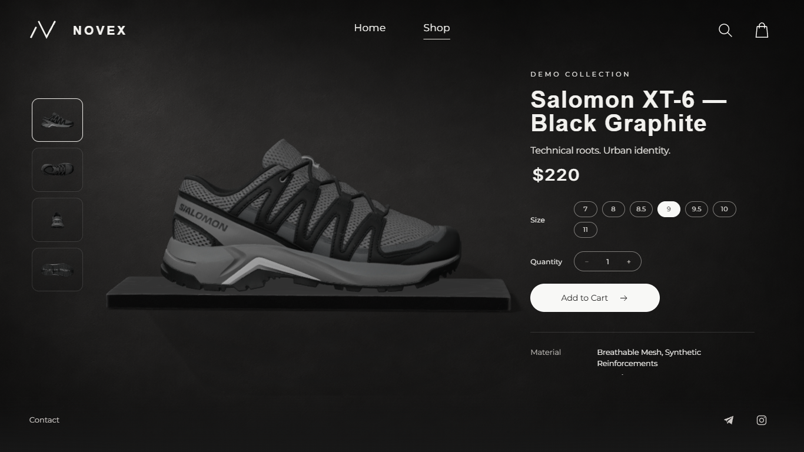
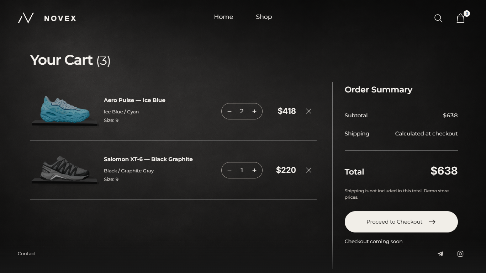

# NOVEX

A premium sneaker-store concept with interactive 3D product views. An independent portfolio demonstration by [jeisei](https://github.com/jeisei), with no affiliation to the brands shown.

**Live site:** [NOVEX on Netlify](https://novex-showcase-maxsweed918.netlify.app/). This release candidate is not yet published; see [release status](docs/release/REPORT.md).



| Collection | Product | Shopping bag |
| --- | --- | --- |
|  |  |  |

## Features

- Minimal text-only Home on desktop and mobile, with no decorative image or 3D download.
- Ten sneakers in a shelf gallery with restrained hover lighting.
- Product-name search with keyboard navigation and a native modal dialog.
- Immediate previews followed by the selected GLB, without blocking purchase controls.
- Free rotation, side/top/rear/sole views, and Home/R keyboard reset.
- Sizes, quantities, persistent shopping bag, catalog-based totals and safe handling of damaged storage.
- Shared dark background and contact area, responsive layouts and reduced-motion support.

## Stack

Vite, ES modules, vanilla JavaScript, CSS, Three.js, GLTFLoader, MeshoptDecoder, GSAP and localStorage. No application framework, backend or payment service.

## Development

Use Node.js 24 LTS (minimum 22.12).

```sh
npm ci
npm run dev
```

The development site runs at `http://127.0.0.1:5173`.

```sh
npm run lint
npm test
npm run check:assets
npm run build
npm run preview
```

Production preview: `http://127.0.0.1:4173`. Routes: `/#/`, `/#/shop`, `/#/product/vx-005`, `/#/cart`.

Browser audit:

```sh
npx playwright install chromium
npm run build
npm run test:browser
```

The audit uses disposable contexts and writes screenshots/measurements to `docs/release/`. Set `NOVEX_TEST_URL` to audit another served build. Timings are laboratory measurements, not field Core Web Vitals.

## Structure

```text
src/
  app/          Routing, abortable lifecycle, persistent shell and transitions
  animations/   GSAP feedback and shared-element geometry
  components/   Markup, search, sculpture and product presentation
  data/         Catalog, cart store and asset/render metadata
  pages/        Home, Shop, Product and Cart
  styles/       Tokens and page styles
  three/        Loading, leases, controls, rendering and disposal
  utils/        Formatting and cooperative scheduling
public/assets/  Optimized GLBs, previews, textures and local fonts
scripts/        Asset checks, browser QA and release packaging
tests/          Node.js unit tests and small fixtures
docs/release/   Release evidence and screenshots
```

Read [ARCHITECTURE.md](ARCHITECTURE.md), [DESIGN.md](DESIGN.md) and [ASSETS.md](ASSETS.md).

## Models and performance

The ten optimized sneaker GLBs occupy **169,857,944 bytes** (about 162 MiB), with individual files of 10.8–26.0 MB. They use Meshopt compression, embedded WebP textures and original geometry. Balenciaga's UV transform correction remains in the presentation layer.

Only the selected sneaker and shared shelf load on Product. Home and Cart do not load GLBs. Shop uses lightweight previews; deliberate desktop hover/focus may prefetch one model. Rendering is event-driven, CPU leases are bounded, and retired GPU resources are disposed or a single desktop viewer is suspended for a quick return.

Optimized models reside in `public/assets/models/` and ship unchanged in `dist/`. Unoptimized originals and Blender work files are excluded. The build checks asset hashes, exact filename case, self-contained GLBs and preview/render compatibility without requiring the author's workstation.

## Netlify

`netlify.toml` sets `npm run build`, publish `dist`, Node 24. Hash routing needs no redirects. Static headers revalidate HTML, cache fingerprinted bundles immutably, and permit local Meshopt WASM/blob workers under CSP.

## Demo limitations and credits

Catalog names, prices and specifications are illustrative. Checkout displays **Checkout coming soon**. No payment, orders, inventory or shipping backend exists. Missing contacts remain explicitly unavailable.

The owner confirms the sneaker models were generated using Meshy's Free plan. **Model created with Meshy — CC BY 4.0 License.** Optimization and previews are adaptations. See [THIRD_PARTY_NOTICES.md](THIRD_PARTY_NOTICES.md) and `public/credits.html` for attribution.

Brand names and marks belong to their respective owners. NOVEX is not an official Nike, New Balance, Salomon or Balenciaga storefront. The source has no blanket reuse license; see [LICENSE.md](LICENSE.md).
